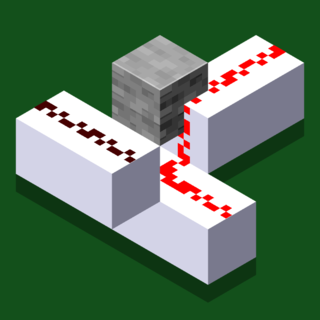
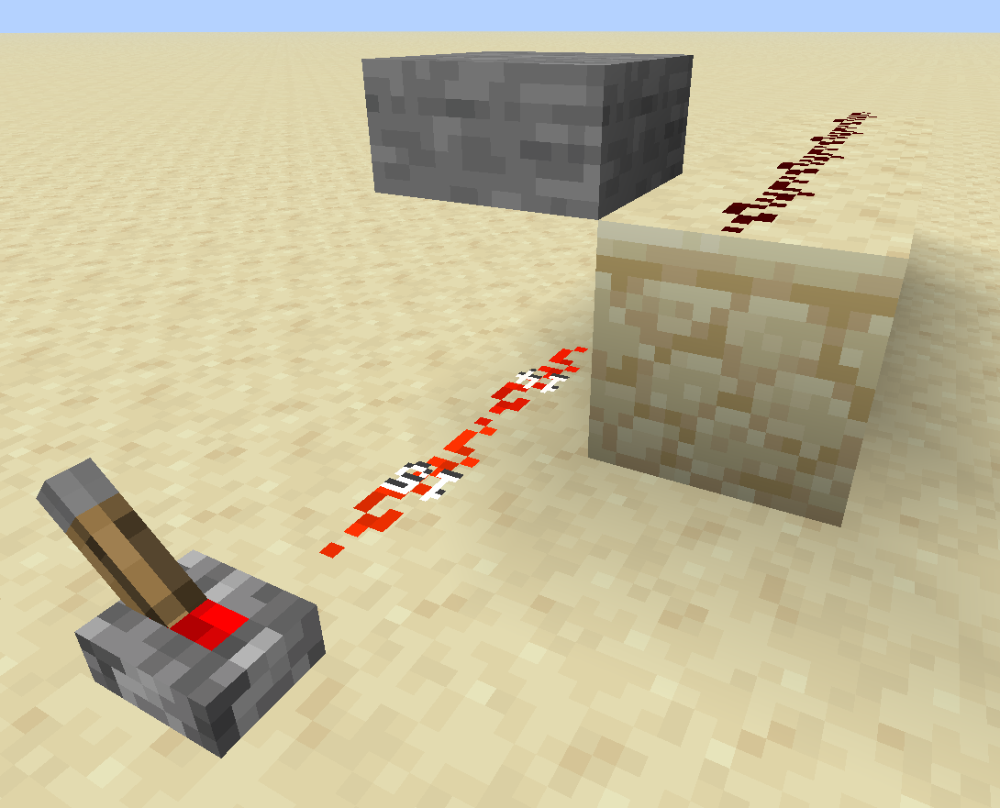
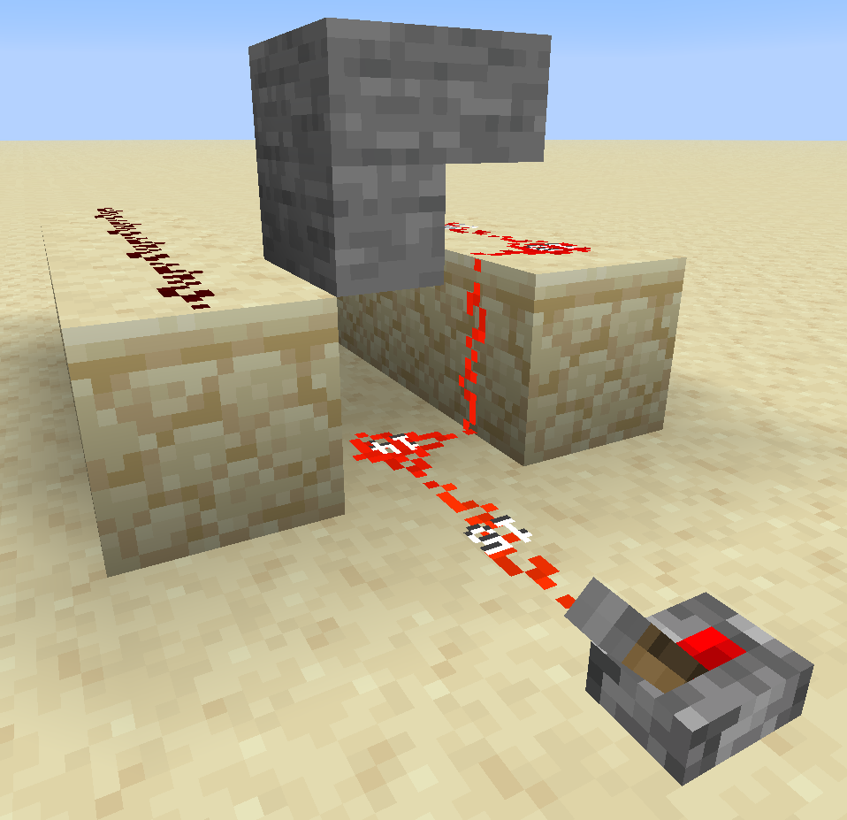
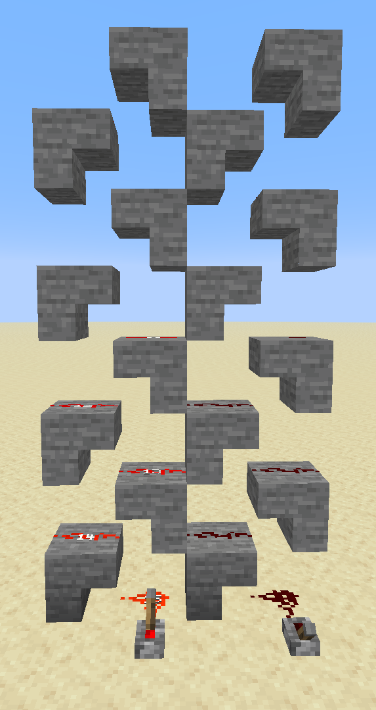
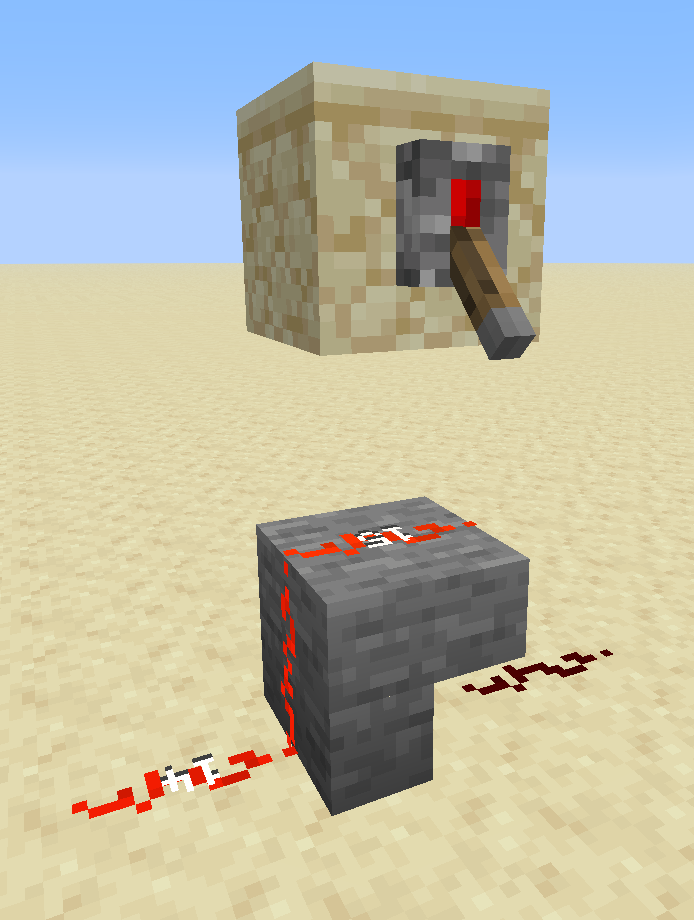
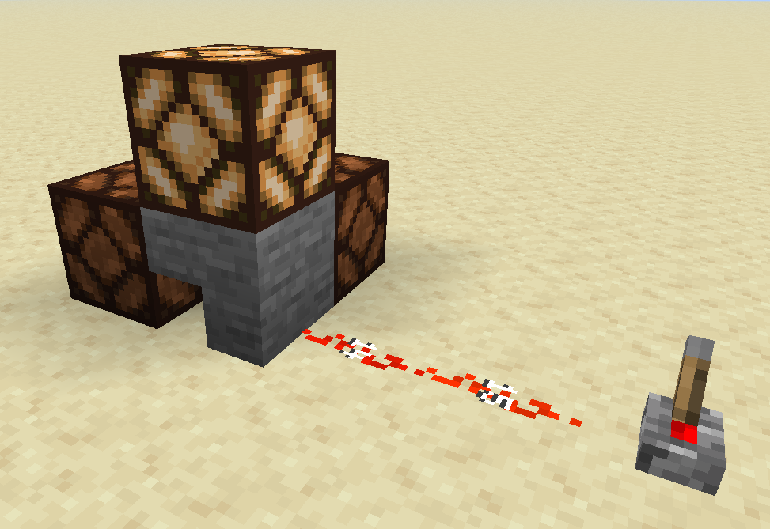
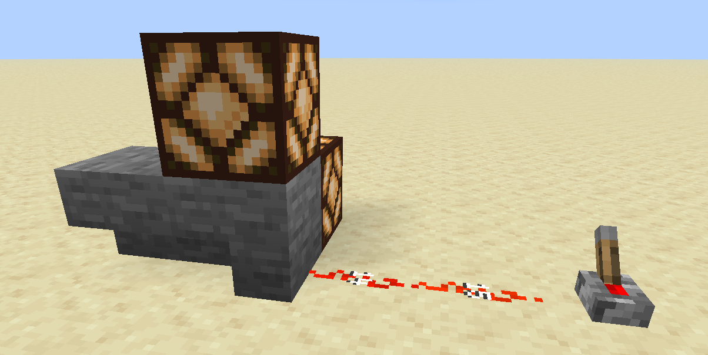
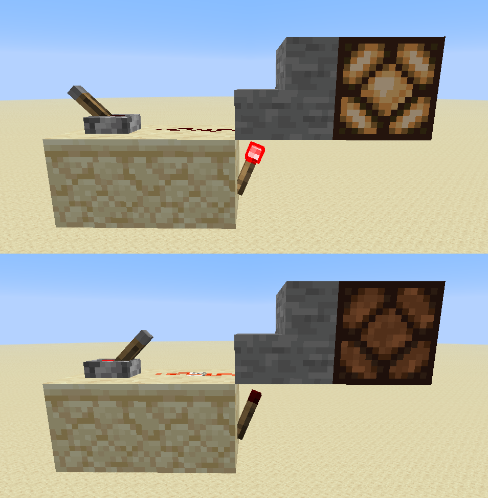
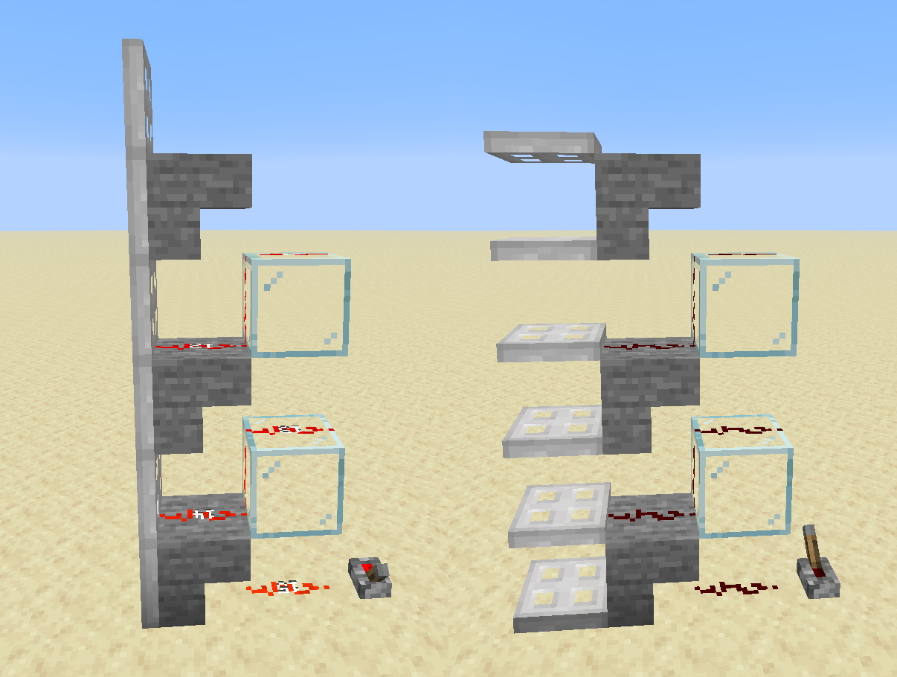

<h2 align="center">
Stairstone<br/><br/>

</h2>

### Allows stairs and slabs to control the directions in which Redstone connects and powers

Thanks to [axialeaa](https://github.com/axialeaa) for creating the mod icon, playtesting, and ideating :3

> [!IMPORTANT]
>
> This mod may not work with [Carpet](https://modrinth.com/mod/carpet), any Carpet addons, any other mod that modifies Redstone behaviour, or Experimental Redstone changes.

> [!NOTE]
>
> This mod is only required on the server, but recommended on the client too. Players without the mod may briefly see the wrong block state when updating a redstone wire, before the server can send the correct block state to the client.

## Redstone blocking
Slabs and stairs will now block Redstone going up if the bottom or side face in that direction is fully covered

Screenshots:
<details>
<summary>Blocking with a slab</summary>


</details>
<details>
<summary>Blocking with stairs</summary>


</details>
<details>
<summary>Adjacent Redstone towers</summary>


</details>

## Redstone going downwards
Redstone can now travel down stairs on the sides which have full faces
<details>
<summary>Screenshot</summary>


</details>

## Directional powering
A Redstone signal running into a stair block will only power the sides that have a full face

> [!NOTE]
>
> Changing the shape of a stair block using a neighbouring stair block does NOT send an update to the powered blocks, or the blocks to be powered. This is a limitation of the mod, but it also adds another way to have blocks in a BUD'ed state, i.e. they are unpowered/powered when they receive the next neighbour update.

Screenshots:
<details>
<summary>Powering a lamp</summary>



</details>
<details>
<summary>Powering a Redstone line</summary>


</details>
<details>
<summary>Torch inverter</summary>


</details>
<details>
<summary>Power tower</summary>


</details>

## Mods and data packs
### Block tags
Mods and data packs can change which blocks affect Redstone connectivity and powering using the following block tags:
- `stairstone:directional_redstone_connects` (directional blocking and downwards Redstone)
- `stairstone:directional_redstone_power` (directional powering)

For blocks with these tags, faces of the block are checked for a full face. Redstone is blocked if the bottom face OR the side face is a full face; Redstone is allowed to travel downwards if the side face is a full face; and a Redstone component is powered if both the side facing the component, and the side facing the power source are full faces.

### Mods
Other mods can specify custom behaviour for Redstone connectivity and powering. Specifically, which sides are treated as a "full face" for the above paragraph.

1. Add the [Spirit Studios Maven repository](https://maven.spiritstudios.dev/#/releases)

    - `build.gradle`
        ```groovy
        repositories {
            exclusiveContent {
                forRepository { maven { url = "https://maven.spiritstudios.dev/releases"; name = "Spirit Studios" } }
                filter { includeGroup("me.sophur") }
            }
        }
        ```

    - `build.gradle.kts`
        ```kotlin
        repositories {
            exclusiveContent {
                forRepository { maven("https://maven.spiritstudios.dev/releases") { name = "Spirit Studios" } }
                filter { includeGroup("me.sophur") }
            }
        }
        ```

2. Add Stairstone as a dependency
    ```kotlin
    dependencies {
        implementation("me.sophur:stairstone:<version>")
    }
    ```
3. Import `me.sophur.stairstone.api.v2.StairstoneBehaviour` and make your `Block` implement one or more of its interfaces:
    - `StairstoneBehaviour.RedstonePower`
    - `StairstoneBehaviour.RedstoneWireConnectivity`

    Your `Block` should also be non-conductive ("transparent")
    ```java
    public MyBlock(Properties properties) {
        properties = properties.isRedstoneConductor(Blocks::never);
        super(properties);
    }
    ```
